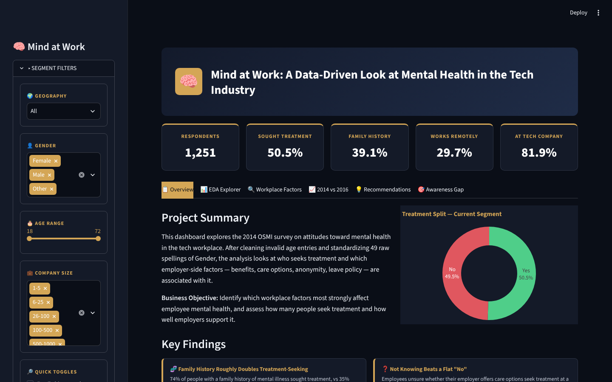

# Mind at Work — Mental Health in the Tech Industry

An exploratory data analysis (EDA) of the 2014 OSMI Mental Health in Tech Survey, with an interactive Streamlit dashboard. It asks which workplace factors are linked to tech employees seeking mental health treatment.

Project 3 of 8 · Built during my Data Analyst Internship at Labmentix (Aug–Nov 2026).




## The business question

Attitudes to mental health at work vary a lot. Companies want to support employees, but they don't know what actually matters: benefits, company size, remote work, or workplace culture. Without that, they risk spending on the wrong things.

**Goal:** find out how many tech employees seek treatment, and which workplace factors are linked to it.

## Key findings

- **About half seek treatment.** 50.5% of respondents have sought treatment for a mental health condition.
- **Family history is the strongest personal factor.** People with a family history of mental illness seek treatment at **74.0%**, against 35.4% without one.
- **Knowing your options matters more than having them.** Employees who know their employer's care options seek treatment at **69.0%**, against about 40% for those who don't know or aren't sure.
- **"Don't know" is worse than "No".** Employees who don't know whether they have mental health benefits seek treatment at **37.1%**. That is lower than those who say "No" (48.2%). Those who say "Yes" are at 63.8%.
- **Fear of consequences silences people.** Among those who expect no negative consequence, **72.7%** would talk to their supervisor. Among those who do expect one, only **8.7%** would.
- **Support comes as a package.** Where anonymity is protected, 39.0% of employers also offer help resources. Where it isn't, only 9.4% do.
- **Some factors barely matter.** Company size (44–56% in every group), remote work (49.7% vs 52.6%) and working at a tech company (49.8% vs 54.0%) make little difference.

## Recommendations

1. **Communicate the benefits you already have.** Awareness is linked to treatment more than the benefit itself.
2. **Make it safe to speak up.** Train managers and make it clear that disclosure will not hurt anyone's career.
3. **Protect anonymity and offer help resources together.** They work as one package.
4. **Don't rely on company size or remote policy** as a way to improve mental health support.

## How it works

1. **Clean the data** (1,259 responses, 27 columns):
   - Grouped 49 free-text gender entries into Male (995), Female (251) and Other (13).
   - Removed 8 rows with impossible ages (for example −1726 and 99,999,999,999), leaving **1,251 rows**.
   - Filled 18 blank `self_employed` values with "No".
   - Kept 264 blank `work_interfere` values as "Not applicable". A crosstab showed these are people without a condition, not missing data.
2. **Encode the answers** as numbers (Yes/No, ordered scales, and 0.5 for "Don't know") so they can be correlated.
3. **Explore with 16 charts**, each with an explanation of why the chart was chosen, the insight, and the business impact. The charts include treatment rates by family history, benefits, care options, company size, age group and remote work, a correlation heatmap, and a word cloud of free-text comments.
4. **Build the dashboard** with sidebar filters and six tabs:

| Tab | What it shows |
|---|---|
| 📋 Overview | Headline KPIs and the main story |
| 📊 EDA Explorer | Demographics, treatment patterns and workplace culture |
| 🔍 Workplace Factors | How employer support links to treatment |
| 📈 2014 vs 2016 | Compares the 2014 survey with the 2016 OSMI survey |
| 💡 Recommendations | Actions for employers |
| 🎯 Awareness Gap | The cost of employees not knowing their benefits |

## Limitations

- **Not representative.** About 79% of respondents are male and about 60% are in the United States, so the results mainly describe that group.
- **Self-selected sample.** People who chose to answer a mental health survey may be more open about the topic than average.
- **Small groups.** The 55+ age group has only 17 people, so its figures are not reliable.
- **Different surveys.** The 2014 and 2016 surveys ask different questions, so the comparison tab only uses the columns they share.
- **Correlation, not cause.** The findings show which groups seek treatment more, not why.

## Run it locally

```bash
git clone https://github.com/Vipsa2207/Mental-Health-In-Tech.git
cd Mental-Health-In-Tech
pip install -r requirements.txt
streamlit run app.py
```

## Project files

| File | What it is |
|---|---|
| `mental_health_eda.ipynb` | Full EDA notebook: cleaning, 16 charts with insights, and conclusions |
| `app.py` | The Streamlit dashboard |
| `survey.csv` | 2014 OSMI Mental Health in Tech Survey (1,259 responses) |
| `mental-heath-in-tech-2016_20161114.csv` | 2016 OSMI survey, used for the comparison tab |
| `requirements.txt` | Python libraries |
| `.streamlit/config.toml` | App theme settings |

## Data source

Open Sourcing Mental Illness (OSMI) Mental Health in Tech Surveys, 2014 and 2016 (public datasets). The dataset was provided for the internship.

## How I built it

I used AI to help write the Python code. I framed the business question, checked every figure against the data, and wrote the findings.

## Author

**Vipsa Patel** — Data Analyst Intern, Labmentix · [LinkedIn](https://www.linkedin.com/in/vipsapatel)
